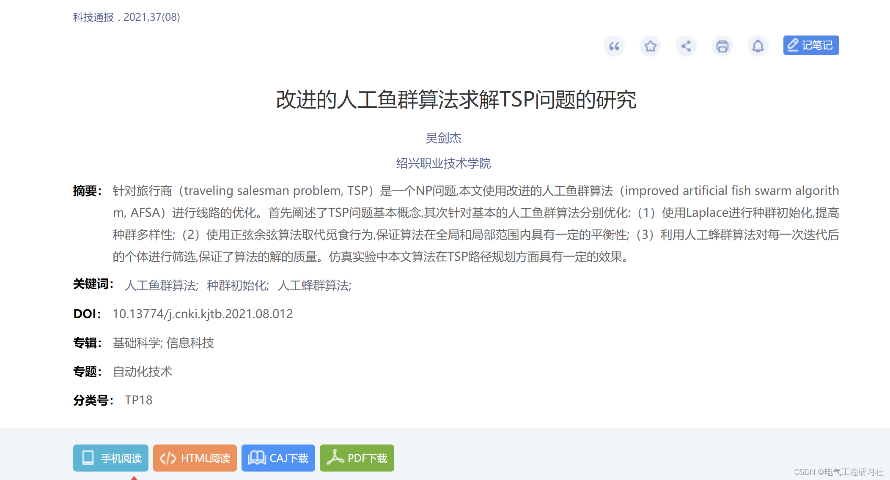
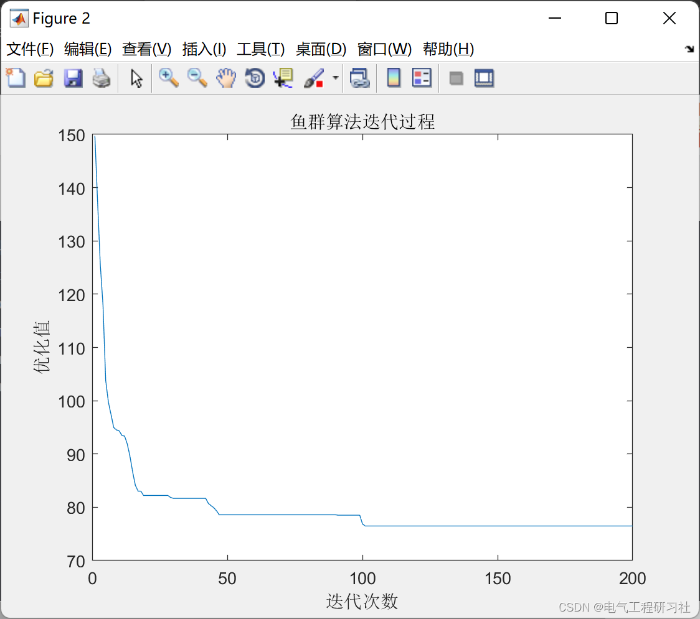

# Research on Improved Artificial Fish Swarm Algorithm for TSP Problem (Matlab Code Implementation)

1. Overview and summary: The Traveling Salesman Problem (TSP) is an NP-hard problem, and this paper uses the improved Artificial Fish Swarm Algorithm (AFSA) to optimize routes. Firstly, it elaborates on the basic concepts of the TSP problem, and then optimizes the basic Artificial Fish Swarm Algorithm separately: (1) Laplace is used for population initialization to enhance the diversity of the population; (2) The foraging behavior is replaced by the sine-cosine algorithm to ensure a certain balance in both global and local scopes; (3) The artificial bee colony algorithm is utilized to filter individuals after each iteration, ensuring the quality of the solution. In simulation experiments, the algorithm proposed in this paper has shown some effectiveness in path planning for the TSP.
Keywords: Artificial Fish Swarm Algorithm; Population Initialization; Artificial Bee Colony Algorithm;
Editor
2 Mathematical model and related explanation - Research on solving the TSP problem using the improved Artificial Fish Swarm Algorithm - China National Knowledge Infrastructure (CNKI.net)
3 MATLAB code implementation - Only a part of the code is presented here, all codes are available at:
clear\nclc\n\ntic                                                                 % Start timing\n\n[num_Citys,CityPosition]=ReadTSPFile('ulysses22.tsp');              % Read .tsp file\n%% Calculate the distance between each pair of cities\nh=pdist(CityPosition);\nD=squareform(h);\n%% Initialize parameters\nFishNum=9;                                                          % Generate 10 artificial fish\nMax_gen=200;                                                        %Maximum number of iterations\ntrynumber=500;                                                      %Maximum number of attempts\nVisual=16;                                                          % Perception Distance\ndeta=0.8;                                                           % Crowding factor\n%% Initialization of fish population, each line represents a fish.\ninitFish=AF_init(FishNum,num_Citys);\n\nBestX=zeros(Max_gen,num_Citys);                                     %Record the optimal path during each iteration\nBestY=zeros(Max_gen,1);                                             %Record the distance of the optimal path during each iteration\nbesty=inf;                                                          % Optimal total distance, initialized to infinity\ngen=1;\ncurrX=initFish;\ncurrY=AF_foodconsistence(currX,D);\nwhile gen<=Max_gen\n    for i=1:FishNum\n        [Xinext,flag]= AF_movestrategy(currX,i,D,Visual,deta,trynumber);\n        currX(i,:)=Xinext;\n    end\n    currY=AF_foodconsistence(currX,D);\n    [Ymin,index]=min(currY);\n    if Ymin<besty\n        besty=Ymin;\n        bestx=currX(index,:);\n        BestY(gen)=besty;\n        BestX(gen,:)=bestx;\n    else\n        BestY(gen)=BestY(gen-1);\n        BestX(gen,:)=BestX(gen-1,:);\n    end\n    disp(['1.',num2str(gen),'Sub-iteration,The optimal value obtained: ',num2str(BestY(gen))]);\n    gen=gen+1;\n    \nend\nfigure\nplot(1:Max_gen,BestY)\nxlabel('Iteration count')\nylabel('Optimization value')\ntitle('Iterative process of the swarm algorithm')\ns=num2str(bestx(1));\nfor i=2:num_Citys\n    s=strcat(s,'->');\n    s=strcat(s,num2str(bestx(i)));\nend\ns=strcat(s,'->');\ns=strcat(s,num2str(bestx(1)));\ndisp(['The optimal path obtained:',s,',Optimal value:',num2str(besty)]);\n\n\ntoc                                                                 % End timer\n  
Editor
4 References [1] Wu Jianjie. Research on improving the artificial fish swarm algorithm for solving TSP problems [J]. Science and Technology Bulletin, 2021, 37(08):66-70. DOI:10.13774/j.cnki.kjtb.2021.08.012.  
5 End Note

## Images

<!-- PAYMENT_BLOCK -->

## Get this dataset

- Payment link (Stripe): [Buy now](https://buy.stripe.com/3cs8yP7sY87d0vu9AB)
- Payment QR code: 

<!-- /PAYMENT_BLOCK -->
